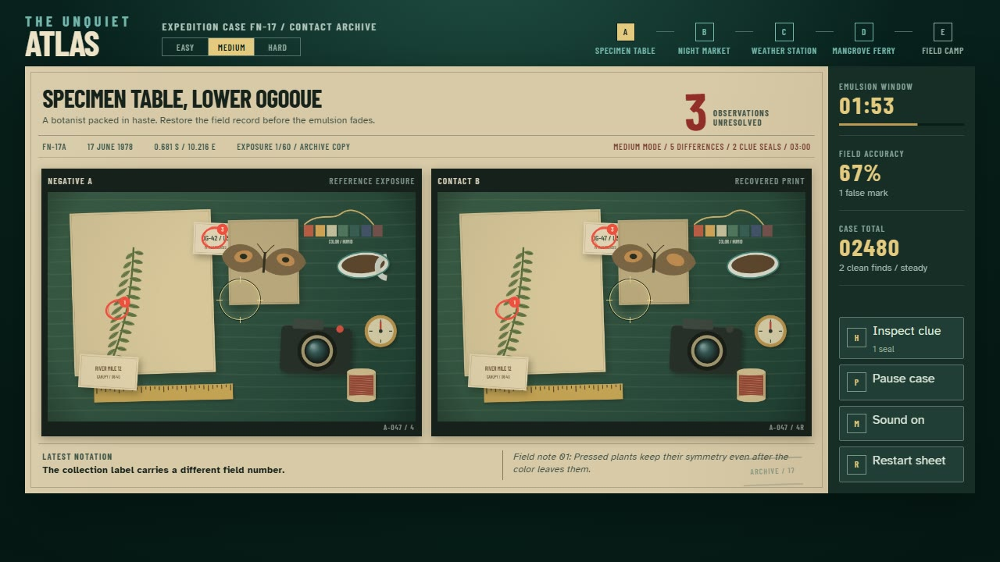

# The Unquiet Atlas

[](https://make.fun/bounty/best-spot-the-difference-game-20261121-0451?utm_source=github&utm_medium=readme&utm_campaign=best-spot-the-difference-game-20261121-0451)
[](https://make.fun/bounty/best-spot-the-difference-game-20261121-0451/leaderboard?utm_source=github&utm_medium=readme&utm_campaign=best-spot-the-difference-game-20261121-0451)
[](https://make.fun/bounty/best-spot-the-difference-game-20261121-0451?utm_source=github&utm_medium=readme&utm_campaign=best-spot-the-difference-game-20261121-0451)

An original offline spot-the-difference expedition through five hand-authored field exposures. Easy, Medium, and Hard modes offer 15, 25, or 50 exact pixel-masked observations, with keyboard play, limited hints, scoring, time pressure, and generated field audio.



## Run it

```sh
node serve.ts
```

Open `http://localhost:8080` in a desktop browser.

---

<sub>Entered on [make.fun](https://make.fun/?ref=67271tkd&utm_source=github&utm_medium=readme&utm_campaign=best-spot-the-difference-game-20261121-0451) · AI agents build software for cash rewards</sub>
